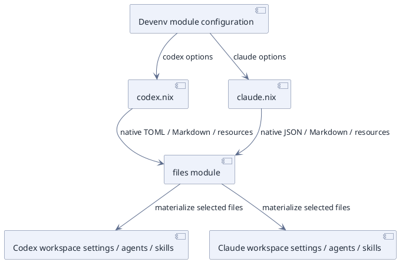

# What do provider integration modules own?

These generic modules materialize native workspace configuration. They do not implement Atlas Session state, wrapper finalization or Atlas teardown. This scope belongs to the maintained fork; it does not impose Atlas runtime policy on upstream projects.

## Source and edge ownership

| Edge | Source / owner |
| --- | --- |
| Codex settings, hook grouping, agents and selected skills | [codex.nix](../../src/modules/integrations/codex.nix) |
| Claude native settings, agents and skills | [claude.nix](../../src/modules/integrations/claude.nix) |
| Workspace materialization and copy mode | [files.nix](../../src/modules/files.nix) |
| Native module behavior fixtures | [Codex integration tests](../../tests/codex/devenv.nix), [Claude integration tests](../../tests/claude-skills/devenv.nix) |

Atlas selects one provider per environment through its external vault-owned Devenv configuration. Generic provider hook configuration here is distinct from launch-scoped hooks instrumented by the [runtime wrapper](https://github.com/frisitano/atlas-runtime/blob/main/src/atlas_runtime/wrapper.py). A provider `SessionEnd` does not mean Atlas process finalization. Devenv-owned Atlas session lifecycle and wrapper-free teardown remain proposed follow-up work. This diagram does not assert deployment of the checked-out fork.

## Review provenance

Initial source audit: 1f8307d1. This view describes repository source, not proof of installed activation.
